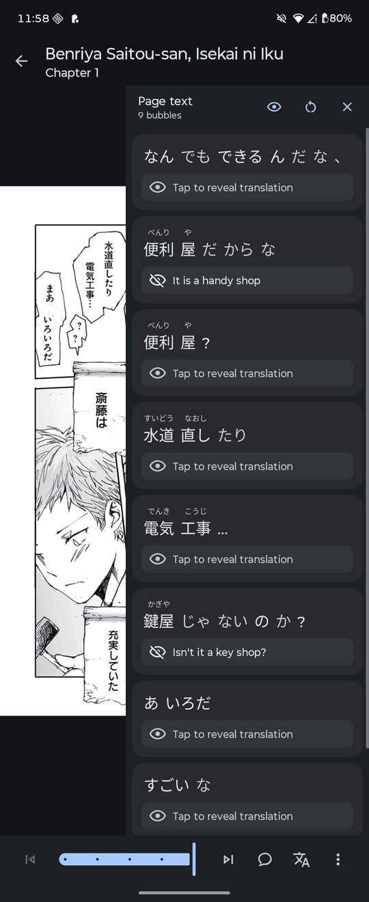
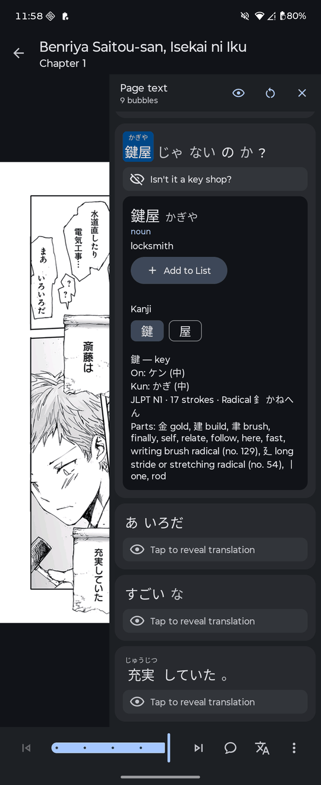

# Kotatsu-Redo-OCR

**A fork of [Kotatsu-Redo](https://github.com/Kotatsu-Redo/Kotatsu-Redo) for reading Japanese manga as a learner.** It adds a sidebar to the reader that pulls the Japanese text off the page you are reading, splits it into words you can look up, and lets you save those words straight to your [renshuu](https://www.renshuu.org/) study lists. Everything else is Kotatsu-Redo as-is (see below).

It installs as its own app, **Kotatsu-Redo-OCR**, next to Kotatsu-Redo rather than replacing it.

### Japanese learning features

- **Page text sidebar.** A button in the reader's bottom bar opens a sidebar listing every speech bubble on the current page, in Japanese reading order (right to left, top to bottom). It updates as you turn the page. Text recognition runs on the device with [Google ML Kit](https://developers.google.com/ml-kit/vision/text-recognition/v2/android), including for vertical text. On a tablet in landscape, the pin button docks the sidebar beside the page, which shrinks to fit, instead of floating over it. It stays pinned until you unpin it.
- **Words, with readings.** Each bubble is split into words, with furigana over anything containing kanji. Conjugated forms are kept together and looked up by their dictionary form, so 食べていた is one word that finds 食べる.
- **Hidden translations.** Each bubble has an English translation hidden until you tap it, so you can check yourself after reading. Translation also runs on the device; there is a button to reveal them all.
- **Dictionary lookups.** Tap a word for its renshuu entry: reading, part of speech, JLPT level, frequency and definitions. Tap one of its kanji for meanings, on/kun readings, stroke count, radical and parts.
- **Add to your renshuu lists.** Each entry has an **Add to List** button that shows how many of your lists already hold the word. It opens a picker of your vocabulary schedules with a ✓ next to those that already have the word.

    
    
     
    The page text sidebar, with two translations revealed (left), and a word looked up in renshuu with one of its kanji opened (right).

### Setup

1. **Add your renshuu API key**, for dictionary lookups and adding words. Copy your key from renshuu's settings panel on [renshuu.org](https://www.renshuu.org/). Go to **Settings → Services → Japanese learning** and paste it into **renshuu API key**. The summary changes to *Signed in as …* once renshuu accepts it.
2. **Read.** Open a chapter, show the reader controls, and tap the 文A button to open the sidebar.

The same settings screen also has these switches:

| Setting | Default | What it does |
|---|---|---|
| Show OCR button in the reader | On | The 文A button in the reader's bottom bar. It is also under *Reader controls in bottom bar* in the reader settings. |
| Show readings | On | Furigana above words that contain kanji. |
| English translation | On | The hidden translation under each bubble. The first use downloads a language model of about 30 MB. |
| Show which lists a word is in | On | The count on **Add to List** and the ✓ in the list picker. |

### Good to know

- **renshuu's API allows 2000 calls a day.** Nothing is looked up until you tap a word, and answers are remembered for the session.
  - A word lookup costs one call, or two with *Show which lists a word is in* switched on.
  - Opening a kanji costs one call.
  - Opening the list picker for the first time in a session costs two calls.
- **Text recognition and translation stay on the phone.** Only the words you tap, and the words you add, are sent to renshuu.
- **Recognition is good, not perfect.** Plain dialogue reads well. Stylised lettering, sound effects and text crossed by panel lines are often misread or missed. Tap ↻ in the sidebar to read the page again.
- In double-page mode the sidebar reads the current page only.
- Words go into your **vocabulary schedules** and any vocabulary lists you made yourself. Studypad is left out.

---

**[Kotatsu-Redo](https://github.com/Kotatsu-Redo/Kotatsu-Redo) is a free and open-source manga reader for Android with built-in
online content sources. The main goal of the fork is to make the best reading manga app.**

  

### Main Features

-   900+ working online manga sources ([kotatsu-parsers-redo](https://github.com/Kotatsu-Redo/kotatsu-parsers-redo)), with source presets, pinning and automatic mirror switching
-   Search across all your sources at once, by title, author or genre, with filters; sources that work best come first
-   Opt-in community features: comments and ratings on manga, plus shared source reliability that ranks search, Explore and the source catalog, with 🔥 on the most popular sources. No email or password, just a device key you can back up
-   Find the same manga on other sources and migrate your progress with Alternatives
-   Favorites in custom categories, reading history, bookmarks and incognito mode
-   Four reader modes: standard, right-to-left, vertical and Webtoon. Adjustable zoom, gaps, cropping, gestures, volume-key paging and an e-ink mode
-   New chapter checks with an updates feed, optional auto-download of new chapters, and recommendations with genre filters
-   Download manga to read offline (CBZ or folders) and open your own CBZ/ZIP archives
-   Sync favorites and history across devices, using your own sync server if you like
-   Scheduled automatic backups to a folder of your choice or to Telegram
-   Tracking with AniList, MyAnimeList, Kitsu and Shikimori, plus Discord Rich Presence
-   Reading statistics and reading time estimates
-   Home screen widgets for recent manga and your shelf
-   Network tools: proxy, DNS over HTTPS, image proxy and built-in CloudFlare handling
-   Password or fingerprint lock and screenshot protection
-   Material You design for phones, tablets and desktop, with a pure black dark theme
-   Supports Android 6.0 and newer

### In-App Screenshots

    
    
    
    
    
    

 

    
    

### License

You may copy, distribute and modify the software as long as you track changes/dates in source files. Any modifications
to or software including (via compiler) GPL-licensed code must also be made available under the GPL along with build &
install instructions.

### DMCA disclaimer

The developers of this application do not have any affiliation with the content available in the app and does not store
or distribute any content. This application should be considered a web browser, all content that can be found using this
application is freely available on the Internet. All DMCA takedown requests should be sent to the owners of the website
where the content is hosted.

